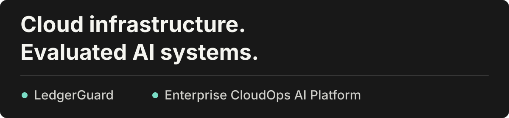

  

DevOps and cloud engineering, with applied AI: infrastructure, delivery automation, and evaluated workflows built for dependable operation.

[Get in touch](#contact) · [Explore my work](#selected-engineering) · [Portfolio](https://jithendra-kantharaju.site/) · [LinkedIn](https://www.linkedin.com/in/jithendra-kantharaju/)

## About

**An infrastructure mindset. An applied AI focus.**

My background spans DevOps, cloud infrastructure, and technical operations in India and the United States, with Terraform, Kubernetes, GitOps, and observability at the core.

My applied AI projects extend that foundation into document processing, retrieval, and incident diagnosis. I focus on decisions that matter in forward deployed engineering: durable workflows, tenant boundaries, authorized human review, and evaluation before execution.

I currently volunteer as an **AI Systems Engineer at Face Friends Foundation**, where I work on fundraising automation across Symphony, Bitrix24, and Wix.

At Corezeal Technologies, I reduced deployment time by **40%** and cut manual infrastructure setup by **about 70%** across four environments.

## Selected engineering

Two projects across cloud infrastructure, operational reliability, and applied AI.

### 01 · LedgerGuard

*Document AI / Financial controls*

An accounts payable workflow that combines structured invoice extraction, deterministic validation, and authorized human review.

- **Approval controls:** Separates invoice extraction from authorization and keeps exceptions available for human review. Shadow mode recorded intended actions without posting QuickBooks bills.
- **Evaluation:** **0 wrong auto-approvals across 425 synthetic invoice tests.** All **225 of 225 problem cases** were held from auto-approval.
- **Test scope:** The frozen test split used offline rules and OCR extraction. Live LLM accuracy and real customer invoice performance were outside that evaluation.
- **Deployment:** Previously demonstrated on AWS ECS Fargate. The demo stack has been decommissioned.

[LedgerGuard repository](https://github.com/Jithendra-Kantharaju/ledgerguard)

### 02 · Enterprise CloudOps AI Platform

*Cloud platform / Agentic AIOps*

An eight-service platform on AWS EKS with infrastructure as code, GitOps delivery, a RAG shopping assistant, and an incident diagnosis agent.

- **Delivery:** Reduced deployment time from **45 to 12 minutes** with parallel builds and GitOps delivery.
- **Incident evaluation:** **93.8% classification accuracy (15 of 16 scenarios)** in offline tests with mocked tool outputs.
- **RAG evaluation:** **95.5% refusal accuracy (21 of 22 scored cases)** within a 26-case suite. The assistant incorrectly refused one return-policy question.
- **Deployment:** The repository documents the EKS deployment and a separate optional Bedrock and Lambda integration. The offline incident evaluation used mocked outputs.

[Enterprise CloudOps AI Platform repository](https://github.com/Jithendra-Kantharaju/enterprise-cloudops-ai-platform)

## Technical skills

- **Cloud platforms:** AWS, Lambda, S3, RDS, CloudWatch, Google Cloud, Azure, OCI
- **Infrastructure as code:** Terraform, Ansible, Helm, Kustomize, Pulumi
- **Containers and orchestration:** Kubernetes, Docker, AWS EKS, Argo CD
- **CI/CD:** GitHub Actions, GitLab CI, Jenkins, Tekton, SonarCloud
- **Observability:** Prometheus, Grafana, ELK, OpenTelemetry, Datadog, CloudTrail
- **Security:** HashiCorp Vault, Trivy, OPA, Conftest, IAM, OIDC, SonarQube, Falco
- **Applied AI:** LangGraph, FastAPI, RAG, ChromaDB, AWS Bedrock, OpenAI, LangChain, Anthropic Claude
- **Languages:** Python, Bash, Go, JavaScript, TypeScript, SQL, HCL, Rego

---

## GitHub activity

  
  

---

## Education & certifications

**M.S. in Computer Engineering** · University of South Florida

- **Anthropic:** Claude Certified Architect – Foundations
- **AWS:** Solutions Architect – Associate, AI Practitioner, Cloud Practitioner
- **Google Cloud:** Associate Cloud Engineer
- **Microsoft Azure:** Azure Fundamentals
- **Oracle Cloud:** OCI DevOps Professional, OCI Foundations Associate, OCI AI Foundations
- **Redis:** Redis Certified Developer

## Contact

Based in the United States and open to DevOps, Cloud, SRE, Forward Deployed Engineering, and AI Engineering opportunities.

[Email](mailto:jithendra.kantharaju@gmail.com) · [LinkedIn](https://www.linkedin.com/in/jithendra-kantharaju/) · [Portfolio](https://jithendra-kantharaju.site/)