<!--
Portfolio profile · editorial systems design
- Positioning · DevOps, Cloud, AI, and Forward Deployed Engineering
- Material · verified project outcomes, local SVG assets, GitHub activity
- Principle · make the work legible before making it decorative
-->

  

  <strong>Cloud platforms that ship reliably. AI workflows that stay accountable.</strong> 
  DevOps · Cloud · Applied AI · Forward Deployed Engineering

  
  &nbsp;
  
  &nbsp;
  

  
  
  
  
  

## What I build

I turn ambiguous operational problems into observable systems: infrastructure that can be deployed with confidence, automation that can be reviewed by people, and AI workflows that fail safely.

| Focus | What that looks like |
| --- | --- |
| **DevOps & Cloud** | AWS, Kubernetes, Terraform, GitOps, CI/CD, observability, and security automation |
| **Applied AI** | LangGraph, RAG, policy-aware agents, structured extraction, and human-in-the-loop workflows |
| **Forward Deployed Engineering** | Translate customer context into a working proof of concept, then document the path to production |

## Evidence of impact

  

<table>
  <tr>
    <td align="center"><strong>40%</strong> faster deployment</td>
    <td align="center"><strong>~70%</strong> less manual setup</td>
    <td align="center"><strong>93.8%</strong> incident classification</td>
    <td align="center"><strong>0</strong> wrong approvals / 425 cases</td>
  </tr>
</table>

## Selected work

### LedgerGuard · policy-aware finance automation

AI-assisted invoice processing built with Python, FastAPI, LangGraph, OpenAI, and PostgreSQL/pgvector. The workflow combines invoice extraction, customer-specific policy checks, three-way matching, human approval, and audit trails.

**Supported result:** In a shadow-mode AWS proof of concept, LedgerGuard validated **425 synthetic invoice cases with zero wrong auto-approvals**.

  

### Enterprise CloudOps AI Platform · operational intelligence

Eight services deployed to AWS EKS with Terraform, GitHub Actions, ECR, Helm, and ArgoCD. The platform also includes a Python/LangGraph incident diagnosis agent and a FastAPI/ChromaDB RAG assistant for operational support.

**Supported results:** Controlled tests achieved **93.8% successful incident classification across 16 mocked scenarios** and **95.5% refusal accuracy across 22 RAG cases**.

  

## Experience

- **Face Friends Foundation** — AI Systems Engineer, September 2026 to present 
  Fundraising workflow integration across Symphony, Bitrix24, and Wix
- **Compass Group USA** — Technical Operations Analyst, August 2025 to May 2026 
  Production infrastructure supporting 10,000+ daily users
- **Corezeal Technologies** — DevOps Engineer, March 2022 to December 2024 
  AWS, Kubernetes, Terraform, Ansible, Jenkins, and GitLab CI
- **Education** — M.S., Computer Engineering, University of South Florida · GPA 3.76/4.0

## Toolkit

  

  
  
  
  
  
  
  
  

---

## GitHub activity

  
  

---

## Credentials

  

## Let’s build something useful

I’m open to DevOps, cloud, SRE, forward-deployed engineering, and AI systems work—especially opportunities that connect reliable infrastructure with practical automation.

  
  &nbsp;
  
  &nbsp;
  

  

