<!-- A GitHub-only profile. All artwork is hosted inside this repository. -->

  
  
  

I build cloud platforms and automation that engineers can actually operate. My background is in AWS, Kubernetes, Terraform, CI/CD, monitoring and production support. More recently, I've been building and evaluating LLM agents, RAG applications and human-reviewed workflows.

- **Work:** DevOps Engineer at Corezeal Technologies (Mar 2022–Dec 2024); Technical Operations Analyst at Compass Group USA (Aug 2025–May 2026); volunteer AI Systems Engineer at Face Friends Foundation (Sep 2026–present).
- **Education:** M.S. Computer Engineering, University of South Florida (GPA: 3.76/4.0).
- **Interested in:** DevOps, Cloud, Site Reliability, Forward Deployed Engineering and AI Engineering opportunities in the U.S.

The AI evaluation figures come from **controlled project tests**, not independently measured customer production outcomes.

  

**LedgerGuard:** A Python/FastAPI/LangGraph accounts payable automation project. It combines invoice extraction, policy checks, three-way matching, human approval and audit trails. The AWS demonstration used ECS Fargate, Cognito, RDS, S3 and GitHub Actions in **shadow mode**, without posting external accounting transactions. In offline evaluation, 425 synthetic invoices produced zero wrong automatic approvals.

  

**Enterprise CloudOps AI Platform:** An AWS EKS environment shipping eight services through Terraform, GitHub Actions, ECR and ArgoCD. Includes an incident-triage agent using CloudWatch/Prometheus/EKS tools and a FastAPI/ChromaDB RAG assistant. Evaluation: **93.8% (15/16)** on mocked incident scenarios and **95.5% (21/22)** on the RAG refusal tests.

  

**DevSecOps Reference Infrastructure:** A security-focused Kubernetes and CI/CD reference featuring Trivy scanning, OPA/Conftest policy checks, Vault secrets, Falco runtime monitoring, and IAM OIDC authentication.

  

**GitOps CI/CD on AWS EKS:** Terraform-provisioned Kubernetes infrastructure, container builds and checks in GitHub Actions, and declarative delivery through Helm and ArgoCD.

Statistics and activity refresh automatically from GitHub's API. Until the first workflow succeeds, the SVGs display setup notices instead of made-up numbers.

  
  
  

