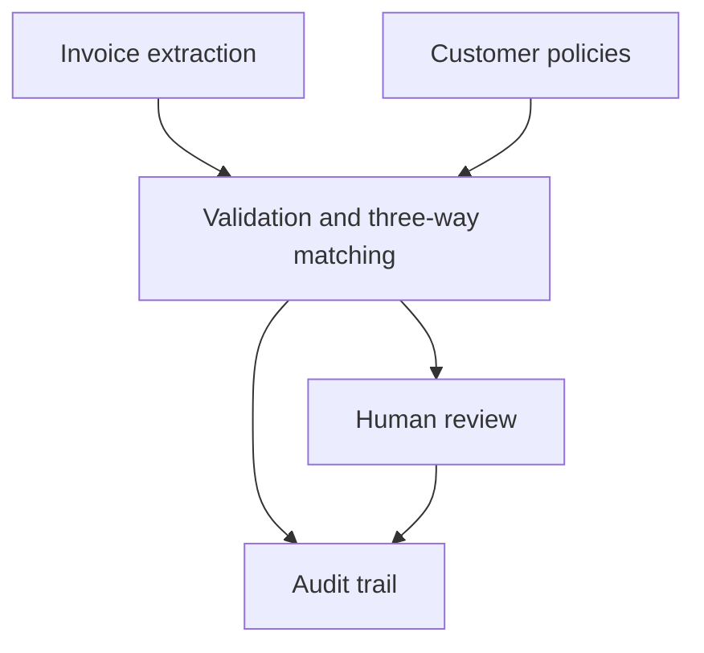
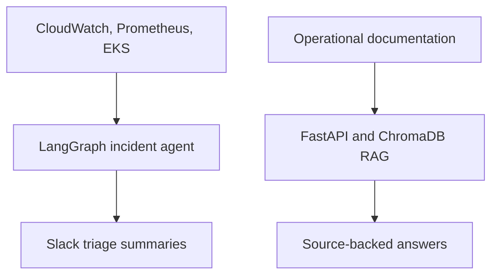

# Jithendra Kantharaju

**DevOps & Cloud Engineer | AI Engineer | Forward Deployed Engineering**

I build cloud infrastructure, automate software delivery, and develop AI workflows with evaluation, human review, and clear audit trails.

[Portfolio](https://jithendra-kantharaju.site/) · [LinkedIn](https://www.linkedin.com/in/jithendra-kantharaju/) · [Email](mailto:jithendra.kantharaju@gmail.com)

## About

Nearly 3 years of DevOps and cloud engineering experience at **Corezeal Technologies**, working across AWS, Kubernetes, infrastructure automation, CI/CD, and observability.

Currently volunteering as an **AI Systems Engineer at Face Friends Foundation**, working on fundraising workflow integrations across Symphony, Bitrix24, and Wix.

Previously supported POS and meal-card operations serving **10,000+ daily users** at Compass Group USA.

**M.S. Computer Engineering, University of South Florida** · GPA: 3.76/4.0

## Engineering impact

- Reduced deployment time by **40%** through Jenkins and GitLab CI pipelines at Corezeal.
- Reduced manual infrastructure setup by **approximately 70%** using Terraform and Ansible.
- Reduced recurring support tickets by **10–20 per month** through monitoring and troubleshooting improvements.

## Featured projects

### [LedgerGuard](https://github.com/Jithendra-Kantharaju/ledgerguard)

**AI-assisted invoice processing with reviewable decisions.**

Built an accounts payable workflow using Python, FastAPI, LangGraph, OpenAI, and PostgreSQL/pgvector.

- Combined invoice extraction, field validation, customer-specific policies, and three-way matching.
- Added human approval and audit trails to make decisions traceable.
- Used shadow mode to evaluate workflow decisions without treating the demonstration as live payment automation.

**Engineering focus:** separate AI extraction from policy checks and preserve human oversight.

### [Enterprise CloudOps AI Platform](https://github.com/Jithendra-Kantharaju/enterprise-cloudops-ai-platform)

**AWS delivery automation, incident diagnosis, and operational knowledge retrieval.**

Deployed **8 services on AWS EKS** using Terraform, GitHub Actions, ECR, Helm, and ArgoCD.

- Built a Python/LangGraph incident agent that correlates CloudWatch, Prometheus, and EKS signals.
- Built a FastAPI/ChromaDB RAG assistant for retrieving operational documentation.
- Achieved **93.8% incident classification accuracy (15/16 mocked scenarios)** and **95.5% RAG refusal accuracy (21/22 test cases)** in controlled evaluations.

**Engineering focus:** combine reproducible infrastructure, GitOps delivery, and explicit AI evaluation.

## Technical toolkit

| Area | Core tools |
|---|---|
| Cloud | AWS, GCP |
| Infrastructure | Terraform, CloudFormation, Ansible |
| Containers and GitOps | Docker, Kubernetes, Helm, ArgoCD |
| CI/CD | GitHub Actions, Jenkins, GitLab CI |
| AI and backend | Python, FastAPI, LangGraph, LangChain, OpenAI API, Anthropic API |
| Retrieval and data | RAG, PostgreSQL, pgvector, ChromaDB, SQL |
| Observability | Prometheus, Grafana, CloudWatch, New Relic |
| Security | IAM, Vault, Trivy |
| Systems | Linux, Bash, Git, REST APIs |

## Certifications

- AWS Certified Solutions Architect – Associate · 2026
- AWS Certified AI Practitioner · 2026
- Google Cloud Associate Cloud Engineer · 2026
- Claude Certified Architect – Foundations · 2026

## GitHub activity

Contribution history and public repository statistics, generated from GitHub data.

View contribution calendar and account statistics

  

  

## Contact

Open to **DevOps Engineer, Cloud Engineer, AI Engineer, and Forward Deployed Engineer** opportunities.

[Email](mailto:jithendra.kantharaju@gmail.com) · [LinkedIn](https://www.linkedin.com/in/jithendra-kantharaju/) · [Portfolio](https://jithendra-kantharaju.site/)