<!--
  JITHENDRA KANTHARAJU / GITHUB PROFILE
  GitHub profile-only. No website, JavaScript, HTML resume, remote stats cards,
  or external animation services. Animations live inside self-contained SVGs.
  The local GitHub Actions workflow populates real activity after its first run.
-->

  <a href="https://github.com/Jithendra-Kantharaju">
    
  </a>

  &nbsp;
  &nbsp;
  

<!-- 01 ABOUT -->


<b>Professional background and education</b>

 

I build and support cloud platforms, CI/CD pipelines and responsible AI workflows.

- **Corezeal Technologies:** DevOps Engineer, March 2022 to December 2024. AWS, Kubernetes, Terraform, Ansible, Jenkins and GitLab CI.
- **Compass Group USA:** Technical Operations Analyst, August 2025 to May 2026. Operational systems supporting 10,000+ daily users.
- **Face Friends Foundation:** AI Systems Engineer, September 2026 to present. Designing fundraising workflow integration across Symphony, Bitrix24 and Wix.
- **Education:** M.S., Computer Engineering, University of South Florida, GPA 3.76/4.0.

<!-- 02 IMPACT -->


<!-- 03 SELECTED WORK -->

<a href="https://github.com/Jithendra-Kantharaju/ledgerguard"></a>

<b>LedgerGuard | Architecture and validation</b>

 

Built an AI-assisted invoice processing system using Python, FastAPI, LangGraph, OpenAI and PostgreSQL/pgvector. It combines invoice extraction, customer-specific policies, three-way matching, human approval and audit trails. An AWS demonstration used Terraform, ECS Fargate, Cognito, RDS, S3 and GitHub Actions in **shadow mode**. Offline evaluation on 425 synthetic invoices recorded **zero wrong automatic approvals**. These are test results, not a production customer deployment.

<a href="https://github.com/Jithendra-Kantharaju/enterprise-cloudops-ai-platform"></a>

<b>Enterprise CloudOps AI | Architecture and evaluation</b>

 

Deployed eight services to AWS EKS using Terraform, GitHub Actions, ECR, Helm and ArgoCD. Developed a Python/LangGraph incident-diagnosis agent with CloudWatch, Prometheus and EKS tools, and a FastAPI/ChromaDB RAG assistant. Controlled tests: **93.8% (15/16)** incident scenarios and **95.5% (21/22)** RAG refusal accuracy. The incident scenarios were mocked, not independently measured production incidents.

<!-- 04 TECHNICAL TOOLKIT -->


<!-- 05 GITHUB ACTIVITY -->


Activity counts come from GitHub. The placeholder graphics do not invent statistics; run the included workflow once to initialize them.

<!-- 06 CREDENTIALS -->


<!-- 07 CONNECT -->


  &nbsp;
  &nbsp;
  

